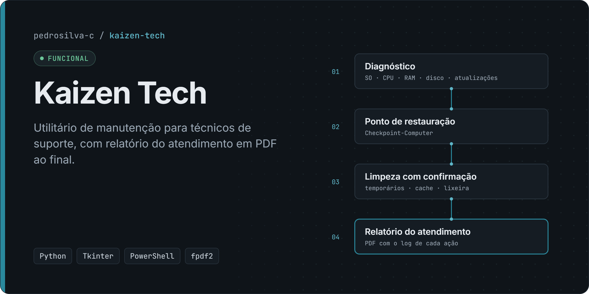
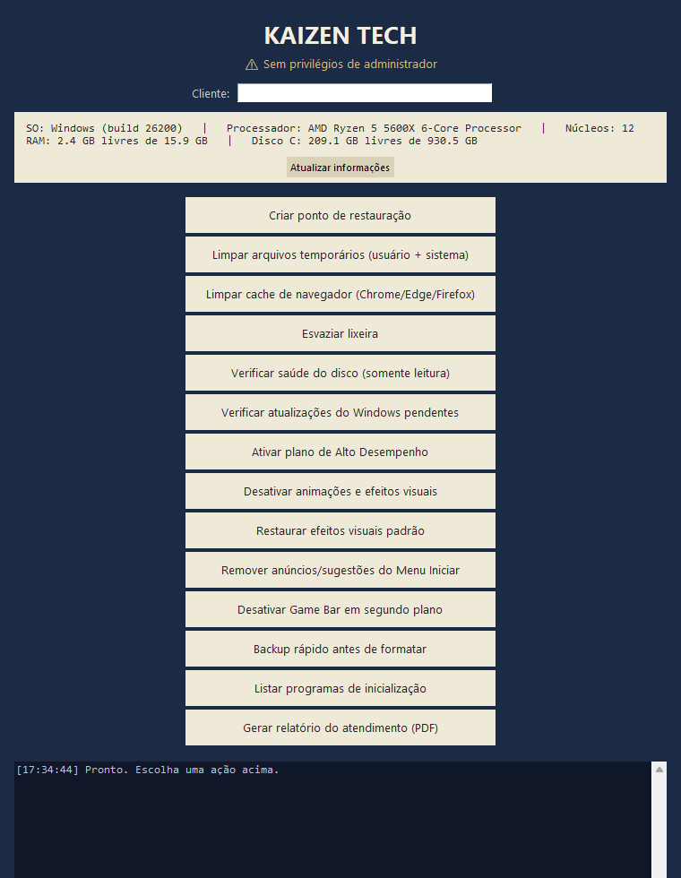

# Kaizen Tech

> **Status: funcional.** Uso pessoal em atendimentos de manutenção. Sem instalador nem assinatura digital.

Ferramenta de manutenção rápida para técnicos de suporte. Reúne as verificações e limpezas mais comuns de um atendimento num só painel e gera, ao final, um **relatório do atendimento em PDF** para o cliente.

**[Portfólio](https://pedrosilva-c.github.io/portfolio/)** · **[Perfil no GitHub](https://github.com/pedrosilva-c)**

## Aviso de segurança

> [!WARNING]
> O programa roda como administrador, altera configurações do Windows e apaga arquivos. Leia os pontos abaixo antes de usar.

- O programa **pede privilégios de administrador** ao iniciar (UAC) e **altera configurações do Windows**: registro (efeitos visuais, sugestões do Menu Iniciar, Game Bar), plano de energia e reinício do Explorer.
- As limpezas **apagam arquivos** em `%TEMP%`, `C:\Windows\Temp`, cache de navegadores e lixeira. O que foi apagado não volta.
- Use **somente em computadores sob sua responsabilidade** ou com autorização do dono, e crie um ponto de restauração antes (há um botão para isso).
- As ações destrutivas pedem confirmação, mas não há "desfazer". "Restaurar efeitos visuais padrão" reverte apenas os ajustes de efeitos visuais.
- **Proteções do processo elevado:** a limpeza nunca segue links simbólicos ou junções (são pulados e contados como ignorados), confere o caminho real de cada item contra a pasta-raiz imediatamente antes de apagá-lo e, em `C:\Windows\Temp` (gravável por qualquer usuário), apaga só os arquivos do primeiro nível, sem entrar em subpastas; e o Explorer é reiniciado **sem** herdar o token de administrador (o Winlogon o reinicia como shell do usuário; o *fallback* usa `runas /trustlevel:0x20000`).
- Revise o código antes de executar. Ele está todo em um único arquivo: [`kaizen_tech.py`](kaizen_tech.py).

## Problema

Em atendimentos de manutenção, as mesmas verificações são feitas à mão a cada máquina, e quase nunca sobra um registro do que foi feito para mostrar ao cliente.

## Funcionalidades

| Ação | O que faz | Confirmação |
|---|---|---|
| Informações do sistema | SO, processador, núcleos, RAM livre/total e disco C: | — |
| Criar ponto de restauração | `Checkpoint-Computer` via PowerShell (o Windows limita a 1 a cada 24 h) | — |
| Limpar temporários | `%TEMP%` do usuário e arquivos do primeiro nível de `C:\Windows\Temp`; contabiliza o espaço liberado | Sim |
| Limpar cache de navegadores | Cache e Code Cache de Chrome, Edge e Firefox | Sim |
| Esvaziar lixeira | API do shell do Windows | Sim |
| Verificar saúde do disco | Consulta **somente leitura** | — |
| Atualizações pendentes | Lista atualizações do Windows ainda não instaladas | — |
| Plano de Alto Desempenho | `powercfg /setactive` | — |
| Desativar / restaurar efeitos visuais | Ajustes de animação no registro do usuário e reinício do Explorer | Sim (desativar) |
| Remover sugestões do Menu Iniciar | Chaves de registro de conteúdo sugerido | Sim |
| Desativar Game Bar em segundo plano | Chave `GameDVR_Enabled` | Sim |
| Backup rápido | Copia Desktop, Documentos e Imagens para uma pasta escolhida | — |
| Programas de inicialização | `Win32_StartupCommand` via PowerShell/CIM | — |
| Relatório do atendimento | PDF na Área de Trabalho, com nome do cliente, espaço liberado e log com horário de cada ação. Cai para `.txt` se o `fpdf2` não estiver disponível | — |

## Tecnologias

Python · Tkinter · ctypes · winreg · subprocess · PowerShell/CIM · fpdf2 · PyInstaller

## Demonstração

Janela principal, capturada em 13/11/2026 a partir desta versão do repositório, **sem privilégios de administrador e sem executar nenhuma ação** (por isso o aviso amarelo no topo). O painel claro mostra as informações reais da máquina usada na captura.



## Arquitetura

Um único módulo Python com interface **Tkinter**:

- **Funções auxiliares puras:** `human_size`, `get_size`, `resource_path`, `_sanitize`. Cobertas por testes.
- **Consultas ao sistema:** `ctypes` (`GlobalMemoryStatusEx`, `IsUserAnAdmin`), `winreg` (nome da CPU) e `shutil.disk_usage`.
- **Ações:** métodos da classe `KaizenApp`, que chamam `subprocess` (PowerShell, `powercfg`, `taskkill`) ou `winreg`. Cada ação registra no log, que alimenta o relatório.
- **Relatório:** `fpdf2`, com a fonte DejaVu para acentuação completa e fallback para Helvetica com saneamento Latin-1.
- **Empacotamento:** PyInstaller com `--uac-admin`, ícone e fontes embutidos ([`KaizenTech.spec`](KaizenTech.spec)).

## Como executar

Requisitos: Windows 10/11 e Python 3.11+.

```powershell
git clone https://github.com/pedrosilva-c/kaizen-tech.git
cd kaizen-tech
py -m venv .venv
.\.venv\Scripts\python.exe -m pip install -r requirements.txt
.\.venv\Scripts\python.exe kaizen_tech.py      # o Windows pedirá elevação (UAC)
```

**Fontes do relatório (opcional, recomendado):** baixe o pacote DejaVu em <https://dejavu-fonts.github.io/> e coloque `DejaVuSans.ttf` e `DejaVuSans-Bold.ttf` numa pasta `fonts/`, ao lado do script. Sem elas, o PDF é gerado com Helvetica e os caracteres fora do Latin-1 (como "—") viram "?". As fontes não estão no repositório para respeitar a licença de redistribuição.

### Gerar o executável

```powershell
.\.venv\Scripts\python.exe -m pip install -r requirements-build.txt
.\.venv\Scripts\pyinstaller.exe KaizenTech.spec
# saída: dist\KaizenTech.exe
```

## Testes

```powershell
python -m unittest discover -s tests -v
```

**14 testes OK (11/11/2026).** Eles cobrem as funções auxiliares, as consultas de leitura ao sistema e a limpeza segura, incluindo um teste que cria uma **junção apontando para fora da pasta** e confirma que o destino não é apagado. **Nenhum teste executa as ações de manutenção sobre o sistema real.** As ações foram validadas manualmente em máquina própria.

## Limitações e status

**Status atual: funcional.** Uso pessoal em atendimentos de manutenção.

- Não há testes automatizados para as ações que alteram o sistema (exigiriam uma VM descartável). O reinício do Explorer sem elevação foi implementado após a revisão de segurança e ainda precisa de validação manual.
- Risco residual conhecido: a exclusão ainda é feita por caminho, não por *handle*. A janela de corrida é mínima e não atravessa links, mas não é nula.
- A interface trava durante ações longas: tudo roda na thread do Tkinter.
- No Chrome e no Edge, a limpeza de cache cobre apenas o perfil `Default` (no Firefox, todos os perfis).
- Executável não assinado: o SmartScreen pode alertar.
- Só funciona no Windows.

## Autor

**Pedro Henrique da Silva Pereira** · [Portfólio](https://pedrosilva-c.github.io/portfolio/) · [LinkedIn](https://www.linkedin.com/in/pedrosilva-sistemas/)
